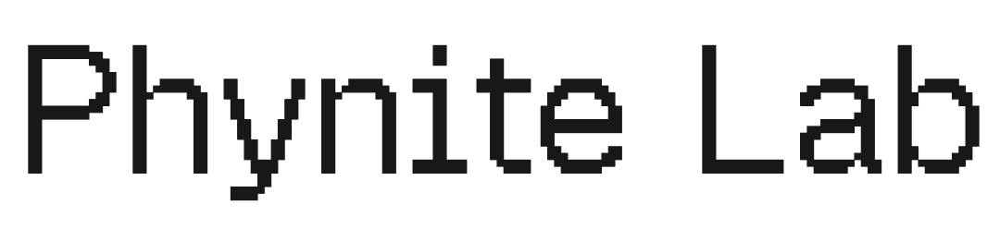
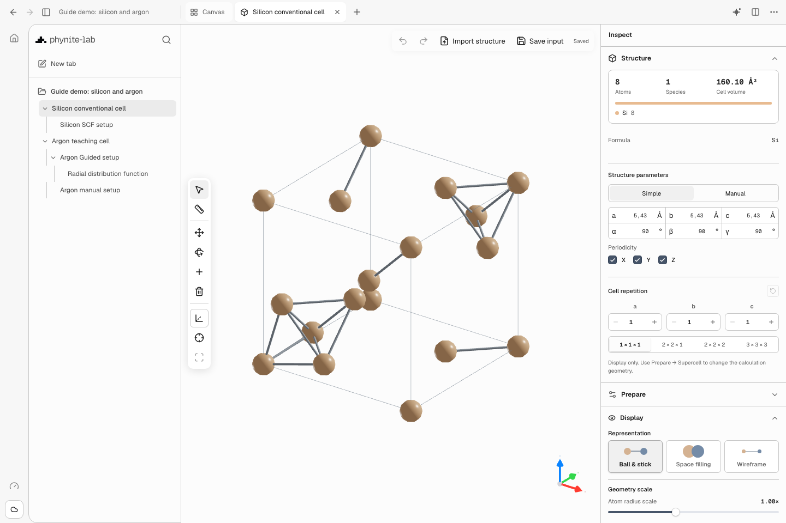
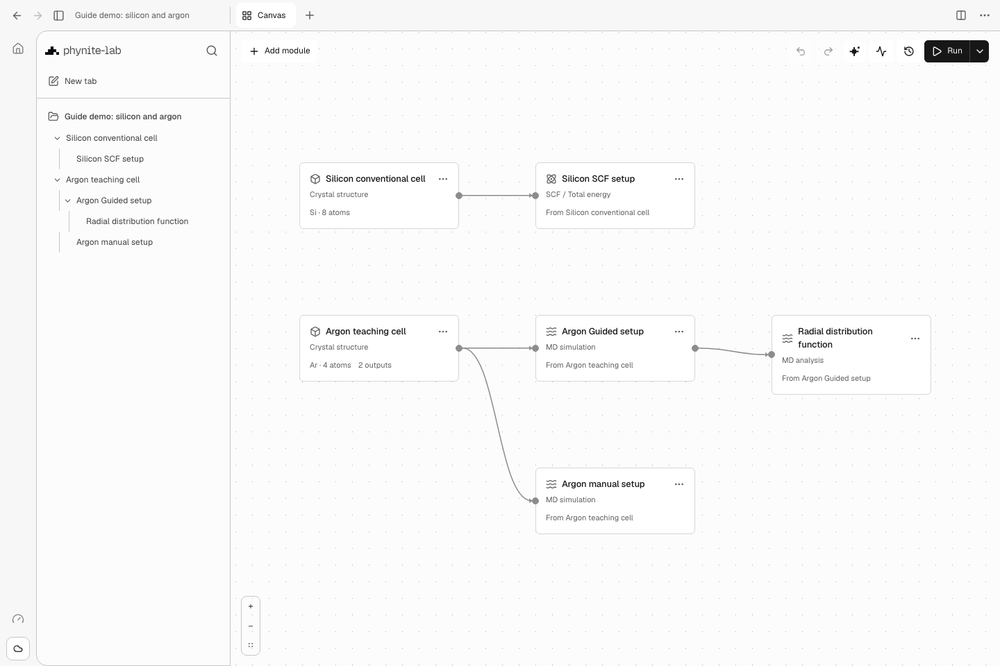
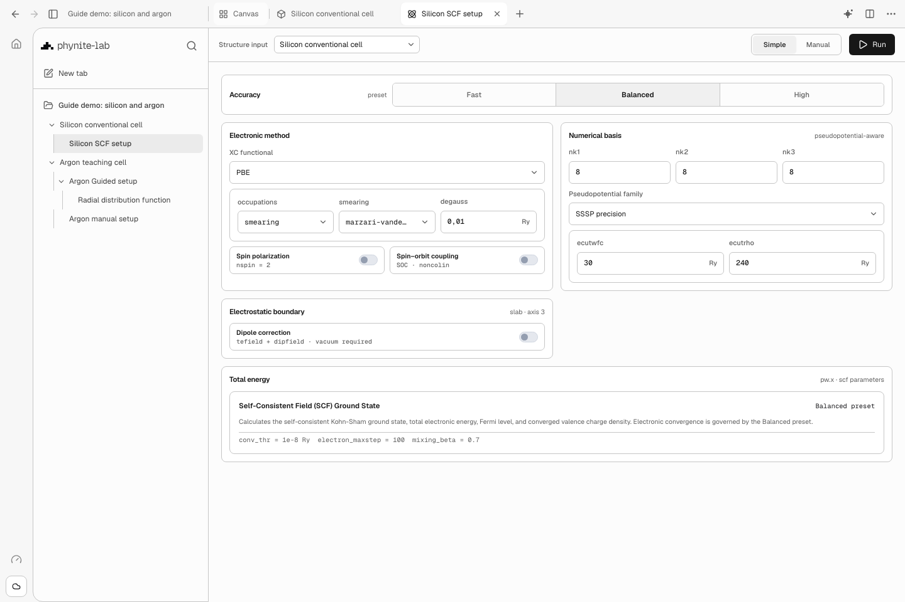

<p align="center">
  <picture>
    <source media="(prefers-color-scheme: dark)" srcset="public/brand/phynite-mark-light.png">
    
  </picture>
</p>

<h1 align="center">
  <picture>
    <source media="(prefers-color-scheme: dark)" srcset="public/brand/phynite-wordmark-light.png">
    
  </picture>
</h1>

<p align="center">
  <strong>A local workspace for computational materials science.</strong><br>
  Crystal structures, Quantum ESPRESSO DFT, LAMMPS molecular dynamics,<br>
  analysis and scientific figures in one open-source application.
</p>

<p align="center">
  <a href="https://www.npmjs.com/package/phynite-lab"></a>
  <a href="https://github.com/phynite-lab/phynite-lab/actions/workflows/ci.yml"></a>
  <a href="https://nodejs.org/"></a>
  <a href="LICENSE"></a>
</p>

<p align="center">
  <a href="#get-started">Get started</a> ·
  <a href="https://phynitelab.com/guide">User guide · EN / ID</a> ·
  <a href="https://github.com/phynite-lab/phynite-lab/releases">Releases</a> ·
  <a href="CONTRIBUTING.md">Contribute</a>
</p>

<picture>
  <source media="(prefers-color-scheme: dark)" srcset="public/docs/guide/structure-editor-desktop-dark.png">
  
</picture>

<p align="center"><sub>A silicon unit cell in the structure editor. Screenshots follow your GitHub theme.</sub></p>

## From structures to results

Connect a crystal structure to a Quantum ESPRESSO calculation or a LAMMPS
simulation on the workflow canvas. Keep the inputs, execution logs and results
in the same project, then pass the results to an analysis module.

| Work with | What you can do |
| --- | --- |
| Crystal structures | Import, inspect and edit structures in 3D; browse crystal databases and prepare primitive cells, conventional cells and supercells. |
| Quantum ESPRESSO | Configure DFT workflows for SCF, relaxation, bands, density of states, phonons and transport. |
| LAMMPS | Prepare guided or manual molecular dynamics runs, inspect trajectories and connect analysis modules. |
| Workflow canvas | Connect structures, calculations and analysis with explicit dependencies. |
| Results & figures | Inspect execution history, logs and artifacts; create scientific figures and export data. |
| HPC clusters | Submit QE jobs over SSH to Slurm or OpenPBS using your institution's installed scientific environment. |
| Optional AI | Connect your own provider CLI to read scientific files, prepare research artifacts and work with project workflows. |

<table>
  <tr>
    <th width="50%">Connect your workflow</th>
    <th width="50%">Configure a calculation</th>
  </tr>
  <tr>
    <td>
      <picture>
        <source media="(prefers-color-scheme: dark)" srcset="public/docs/guide/workflow-canvas-desktop-dark.png">
        
      </picture>
    </td>
    <td>
      <picture>
        <source media="(prefers-color-scheme: dark)" srcset="public/docs/guide/dft-configuration-desktop-dark.png">
        
      </picture>
    </td>
  </tr>
</table>

The screenshots use the guide's silicon and argon teaching inputs. They show
draft setups with no computed results. For step-by-step instructions, read the
[user guide](https://phynitelab.com/guide) in English or Indonesian.

## Get started

Install [Node.js 22.13 or later](https://nodejs.org/), then run:

```sh
npm install -g phynite-lab
phynite-lab
```

The launcher opens the app in your browser at a loopback address and saves your
work in `~/.phynite-lab`. A complete published package includes the app and native
backend. You don't need Docker, a global Python installation, a source checkout
or a Cloud account. Leave npm optional dependencies enabled; npm uses them to
select the native package for your platform.

**Before your first calculation:**

1. Open **Settings → Compute** and install **DFT** and/or **MD & analysis**.
   Solver runtimes are separate downloads from the application.
2. Verify the detected platform, required solver capability and isolation probe.
   Select the required potentials separately under their own licenses. For DFT,
   install the chosen pseudopotential library or provide the exact UPF files.
3. Create a small reference calculation, select **Your computer** in the run
   review and inspect the final state, numerical output, execution log,
   provenance and checksums before moving to a larger workflow.

For the full setup and troubleshooting path, see
[install, update and diagnose](https://phynitelab.com/guide/npm-local-app).

<details>
<summary>Pseudopotentials and failed runs</summary>

For SSSP inputs, install **Precision** or **Efficiency** under **DFT
pseudopotentials**. Downloads use the pinned official Materials Cloud release,
retain its license notices and are checked before activation. Installing a
library preserves your selected physical settings. You can also upload UPF files
without installing a library.

If a run fails, open the module's **Execution result** for the reason,
**Execution log** and retained artifacts. A setup or preflight failure happens
before the solver starts and has no solver output. A failure after startup has
an execution log and any retained artifacts; inspect the first solver error
before changing an input. Correct the issue and start a new run. Failed attempts
remain in history.

</details>

### Platforms

| Platform | Native package | Requirements |
| --- | --- | --- |
| macOS · Apple Silicon | `darwin-arm64` | Node.js ≥22.13 |
| Linux · x64 | `linux-x64` | Node.js ≥22.13, glibc ≥2.39, unprivileged user namespaces |
| Linux · ARM64 | `linux-arm64` | Node.js ≥22.13, glibc ≥2.39, unprivileged user namespaces |
| Windows · WSL2 | Linux x64 package | Run inside a compatible WSL2 Linux environment |

Linux packages include the verified bubblewrap sandbox. Check the matching
[release qualification evidence](docs/local-release-evidence.md) for the targets
tested for each version. Package availability alone does not verify a specific
Windows or Omarchy desktop. The [distribution guide](docs/local-distribution.md)
covers platform setup and caveats.

<details>
<summary>Launcher commands and updates</summary>

```sh
# Choose a port and workspace without opening the browser
phynite-lab --no-open --port 3000 --data-dir /path/to/workspace

# Inspect, stop or diagnose the default workspace
phynite-lab status
phynite-lab stop
phynite-lab doctor

# Stop the running app before updating, then launch it again
npm install -g phynite-lab@latest
```

For a custom workspace, pass the same `--data-dir` to `status`, `stop` and
`doctor`. Restarting the app or updating the package preserves saved data.

The launcher checks npm for updates in the background and displays a notice
when a newer version is available. It never installs updates automatically.
Successful checks are cached for up to six hours and failed/offline checks for
five minutes. You can keep working when the registry is unavailable.

</details>

## Local by default

Projects, inputs and results live on your computer, with SQLite for metadata and
files for artifacts. Local work needs no login. The hosted control plane is
maintained separately and is not required to build or run this application.

Phynite Cloud is optional. Signing in does not upload or sync projects. You
choose Cloud Sync per project and review input transfers separately for cloud
compute.

To use AI, install the official Codex, Claude Code or Antigravity CLI and connect
your own provider account. This is separate from Cloud login. See
[AI provider setup](https://phynitelab.com/guide/ai-providers) and the
[scientific AI guide](docs/scientific-ai-agent.md).

<details>
<summary>Storage, backups and large Quantum ESPRESSO runs</summary>

The default data directory is `~/.phynite-lab`; use `--data-dir` to choose another.
Local mode has no fixed 10 GB allowance or automatic seven-day cleanup. Available
disk is the practical limit. Export important projects and keep an independent
backup before deleting or replacing a workspace.

| Counted by local Storage | Not counted by local Storage |
| --- | --- |
| Inventoried project inputs, results, trajectories and archives | SQLite metadata, installed solvers, runtime/worker logs, browser cache and unrelated disk files |

QE `disk_io`, wavefunctions, `tmp/` and checkpoints can be much larger than final
output and may be needed for bands, DOS, phonons, projected workflows or external
interoperability. Keep them until every downstream workflow finishes. Preserve
the exact input, pseudopotential identity/checksum, provenance and state artifacts.

Wannier90 is an external/manual workflow unless a separately documented integration
is installed. See the [QE documentation](https://www.quantum-espresso.org/documentation/),
[Wannier90 documentation](https://wannier.org/documentation/) and
[storage and backup guide](https://phynitelab.com/guide/storage-backup).

Cloud storage has separate account quotas, retention and Trash rules.

</details>

## Documentation

The [complete user guide](https://phynitelab.com/guide) is available in English
and Indonesian, with downloadable Markdown copies and annotated screenshots.

| Looking for | Start here |
| --- | --- |
| Installation, updates and troubleshooting | [npm local app guide](https://phynitelab.com/guide/npm-local-app) |
| Crystal databases and structure imports | [Crystal database guide](docs/crystal-database.md) |
| SSH, Slurm and OpenPBS configuration | [Local HPC clusters](docs/hpc-clusters.md) |
| AI readers, research artifacts, custom skills and opt-in local MCP tools | [Scientific AI guide](docs/scientific-ai-agent.md) |
| Preferences and local compute setup | [Settings reference](https://phynitelab.com/guide/settings-reference) |
| Local backups and optional project sync | [Storage & backup](https://phynitelab.com/guide/storage-backup) · [Cloud Sync](https://phynitelab.com/guide/cloud-sync) |
| Native packages, solvers and release evidence | [Local distribution](docs/local-distribution.md) · [Native runtimes](docs/native-runtime-releases.md) |

## Develop and contribute

Read [CONTRIBUTING.md](CONTRIBUTING.md) before opening a pull request. It covers
the development workflow, required checks and scientific evidence.

<details>
<summary>Build the local application from source</summary>

Source development needs Node.js and Python for the local backend. Python is not
required for end users of the complete npm package.

```sh
git clone https://github.com/phynite-lab/phynite-lab.git
cd phynite-lab
npm ci
npm run prepare:workflow
npm run build
python3 -m venv .local-backend/venv
.local-backend/venv/bin/python -m pip install -r scripts/local-core-requirements.txt
.local-backend/venv/bin/python scripts/build-local-core.py
```

After preparing the backend dependencies, start an isolated development preview:

```sh
npm run dev:local
```

The development workspace defaults to `~/.phynite-lab-dev`, separate from the
npm launcher's `~/.phynite-lab`. Each workspace has its own runtime installations;
installing solvers in one does not install them in the other. Use `--data-dir`
explicitly to select another workspace and stop its current instance first.

Releases are assembled and published manually. The
[distribution guide](docs/local-distribution.md) and
[native runtime guide](docs/native-runtime-releases.md) list the required source,
checksums, platform qualification, scientific checks and license evidence.
Pushes and CI checks do not publish packages.

</details>

- [Ask a usage question](https://github.com/phynite-lab/phynite-lab/discussions/categories/q-a)
  or [discuss an idea](https://github.com/phynite-lab/phynite-lab/discussions/categories/ideas).
- [Report a bug or request a feature](https://github.com/phynite-lab/phynite-lab/issues/new/choose).
- Report security vulnerabilities through the [private reporting policy](.github/SECURITY.md).

Please follow our [Code of Conduct](.github/CODE_OF_CONDUCT.md).

## License

Phynite Lab is licensed under **GNU Affero General Public License v3 only**
(`AGPL-3.0-only`). Commercial use is permitted under the license. Modified
versions offered over a network must provide corresponding source as required
by AGPL. See [LICENSE](LICENSE).

The app's **Source code and license** link and each release identify the exact
source commit and downloadable source archive. Third-party components and
separately downloaded solver runtimes retain their own licenses, notices and
corresponding-source obligations.
