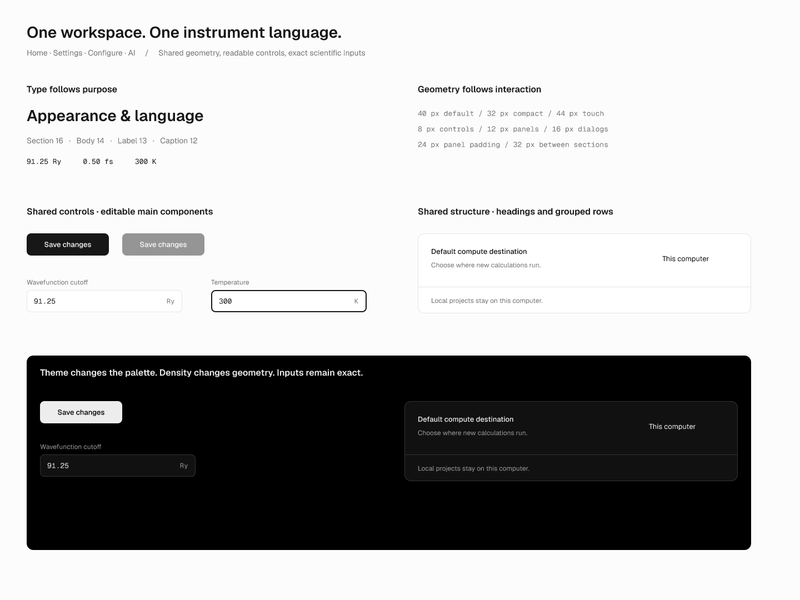

# Workspace design system and UX

Open [workspace-ux.figcraft](workspace-ux.figcraft) in FigCraft. The portable file contains native editable layers, Geist typography, the existing neutral palette, and the shared Phynite AI mark. Lucide vectors reuse the project’s icon dependency; its [ISC and MIT notices](LUCIDE-LICENSE.txt) are included here and in the document’s page metadata. Provider artwork retains the provenance described in [NOTICE.md](../../NOTICE.md).

## Shared foundations

The **Workspace system · shared foundations** board connects the implemented Home, Settings, project Configure, and AI surfaces to one vocabulary:

| Role | Default |
| --- | --- |
| Page / section / body / label / caption | 28 / 16 / 14 / 13 / 12 px |
| Scientific readout | 13 px, Geist Mono; independent code font preference |
| Control height | 40 px default, 32 px Compact, 44 px touch/mobile |
| Control / panel / dialog radius | 8 / 12 / 16 px |
| Panel padding / section gap | 24 / 32 px desktop, 16 / 24 px mobile |
| Page well | 960 px maximum, 20–48 px gutters |

Native text styles cover all six text roles. The **Workspace foundations** variable collection contains 14 semantic palette and geometry variables with Light/Dark modes. The action, scientific field, and grouped Settings panel are reusable main components with instances; action labels and scientific labels, values, and units are exposed as component properties. The board includes disabled and focused examples and explicitly themed dark instances.

## Screens and prototypes

There are 18 top-level artboards: the foundation board, 14 workspace state designs, and three destination references. Home covers first-project, populated, and empty-search states. Settings covers section navigation and contextual search. Configure explains editing modes. AI covers disconnected, checking, unavailable-catalog, and ready states. Four mobile designs accompany the desktop states. Shared text styles and geometry bindings are also applied to the workspace prototypes.

All 39 prototype navigation targets resolve within the document. Home links to project creation, Compute, and AI providers; project navigation connects Configure and AI. The destination references are design references. Browser screenshots in the review describe the implemented geometry more precisely than schematic screen designs.

The original `phynite-lab-ui` document has been refreshed on **Workspace refinement · Home Settings Configure AI**; its other pages are preserved. The portable handoff is approximately 116 KiB and includes its referenced images.

The [consistency review](../reviews/workspace-consistency/README.md) records the implemented layouts, themes, preferences, responsive behavior, and keyboard checks. Example project names and scientific values are input fixtures, never scientific results.
