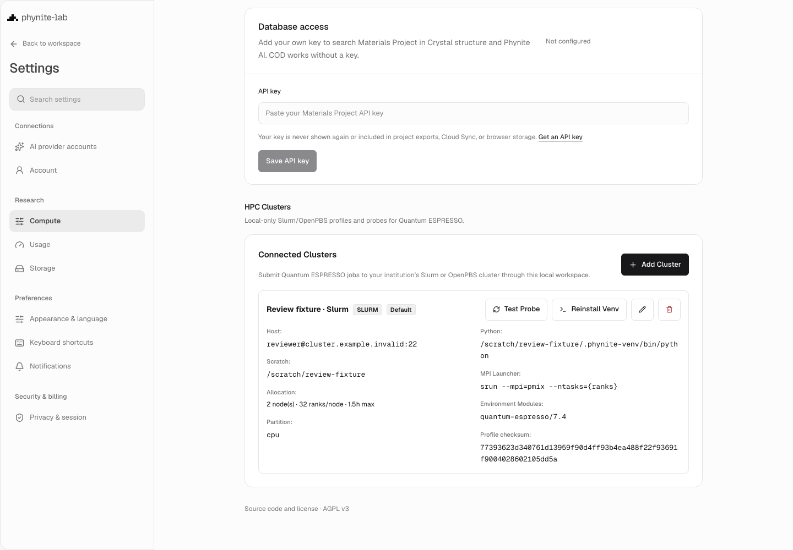
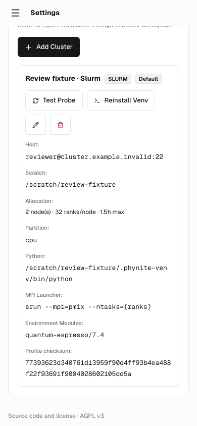

# HPC interface review for 0.1.32

Reviewed PR #89 from `jauhar-nr` against current `main`. The integrated branch
preserves the original interface changes and resolves the `.gitignore` conflict.

Review fixes:

- Missing Slurm accounting/controller records cannot imply a successful exit.
  Observed controller status is usable, while signal exits remain failures.
- Automatic SeeK-path retains disconnected branches. Incomplete custom branches
  are rejected, and raw QE input takes precedence over visual path settings.
- Standalone Bands run preparation preserves model settings based on actual
  connections. Accuracy and SOC changes preserve the selected potential family.
- Successful execution metrics and artifact links remain available alongside
  grouped DFT downloads. Figure ZIP entries retain their distinct directories.
- Bulk compute edits compare the full allocation, identify mixed settings,
  respect MD destination restrictions, and replace stale nested allocations.
- Cluster actions wrap on narrow screens. Fractional walltime and memory units
  are displayed accurately. Compiler reload revalidates the checksum manifest.

Browser inspection used a disposable local data directory and a clearly named
cluster fixture at `cluster.example.invalid`. No SSH connection or live HPC
execution was attempted. Both the card and every action were checked to fit
inside the viewport.

Desktop, 1440 × 1000:

Mobile, 390 × 844:

