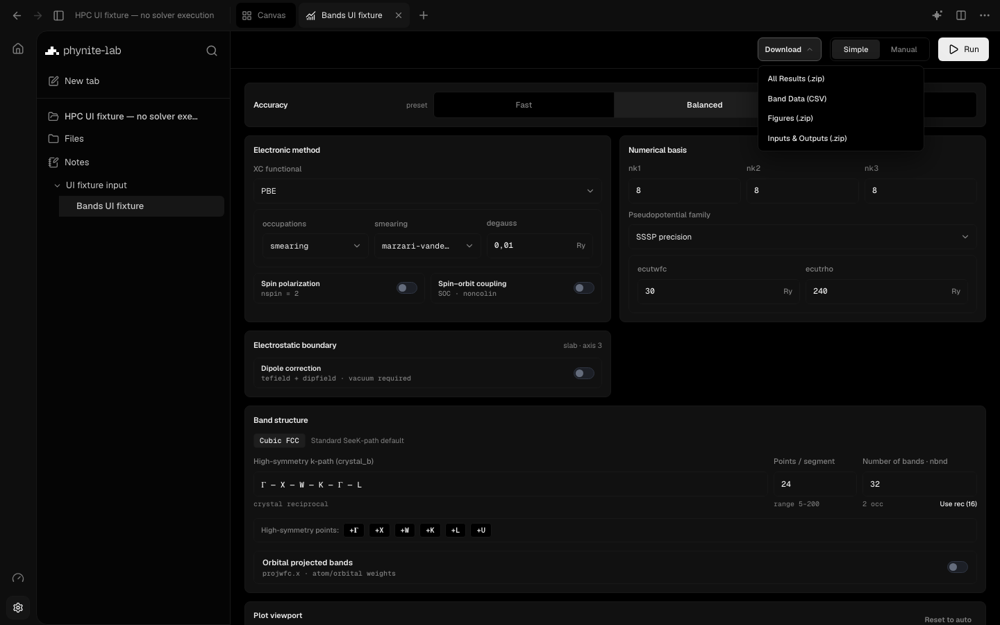
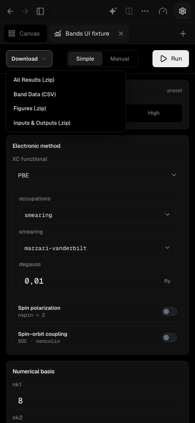

# HPC editor layout correction for 0.1.33

The 0.1.32 review restored an old successful-result card, input selector and
explanatory notices above the DFT configuration. Those additions changed the
composition already implemented in Jauhar's `feat/hpc-ui-ux-and-workflow-run`
branch (`9451cc6340f1b27aea1074526d0ffa69cedb1d2c`).

This correction restores that branch's editor composition and failure/trajectory
presentation. The Download, Simple/Manual and Run controls retain their order.
Scientific, Slurm, allocation and ZIP path fixes from the previous review remain.
Result-fetch failures stay visible, and artifacts clear when no longer available.

`scripts/verify-hpc-download-ui.mjs` fails against the published 0.1.32 editor
because the old result card is present, and passes against this correction at
1440 × 900 and 390 × 844. It also downloads the figures ZIP and checks that
`first/plot.png` and `second/plot.png` remain separate, and verifies visible
result-fetch errors. The same check is required in packaged native acceptance.

These screenshots use a disposable workspace named **HPC UI fixture — no solver
execution**. Workflow attempts and artifact responses are explicitly synthetic
browser fixtures with no scientific result values. No solver, SSH or HPC run was
performed for this visual evidence. Native scientific release qualification is
collected separately by the release workflow.

## Desktop

## Mobile

